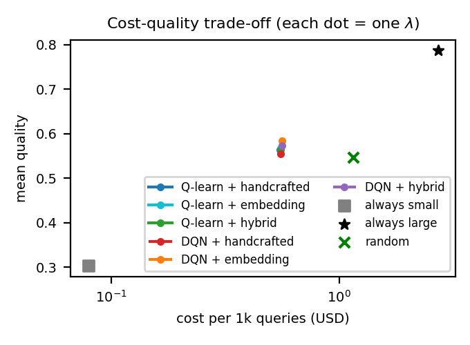
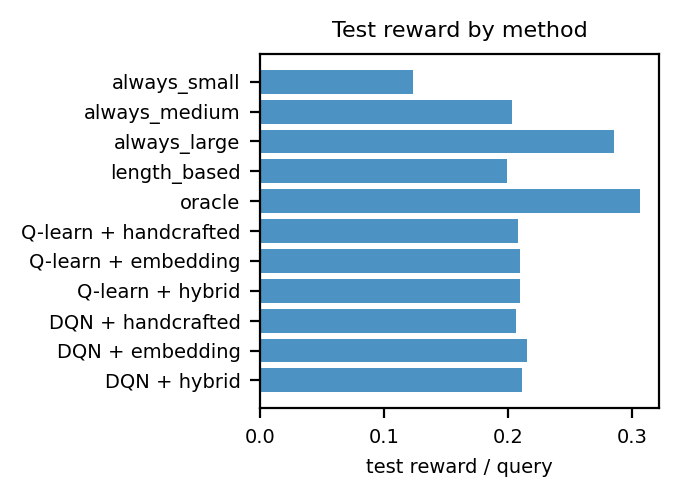
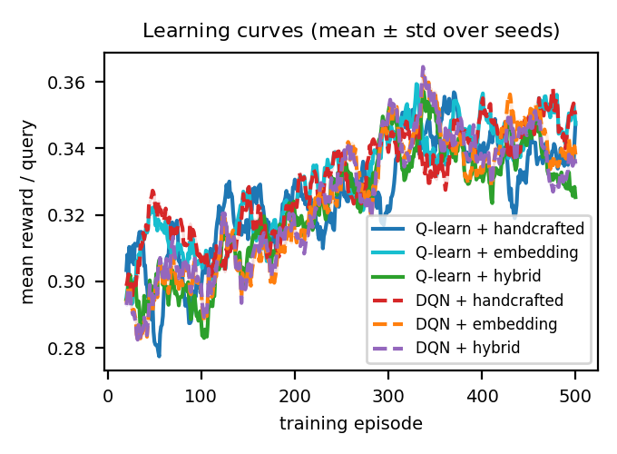

# LLM Router

**Reinforcement-learning policies for cost-aware LLM routing**

This project trains tabular Q-learning and Deep Q-Network (DQN) agents to route a prompt to one of
three language models. It uses recorded per-prompt quality and cost from
[RouterBench](https://huggingface.co/datasets/withmartian/routerbench) for reproducible, offline
training and evaluation.

| Component | Project design |
|---|---|
| **Observation / state** | Handcrafted prompt features, MiniLM embeddings, or both |
| **Actions** | Choose the small, medium, or large model |
| **Training reward** | Benchmark quality divided by estimated prompt difficulty |
| **Cost control** | Online dual-price adjustment with a validation-selected update rate |
| **RL algorithms** | Tabular Q-learning and DQN |
| **Evaluation data** | RouterBench, split into train / validation / test |

> **Assignment scope:** The action-selection policies evaluated here are Q-learning and DQN.
> The implementation also fits auxiliary difficulty and cost predictors from training data. These
> predictors are not routing policies, but they are supervised components; if the assignment
> prohibits supervised components entirely, the current implementation does not strictly satisfy
> that interpretation and those auxiliaries must be replaced.

## Results at a glance

The full run used 36,497 prompts (25,547 train, 5,474 validation, 5,476 test), three seeds, and
500 training episodes. The dual-controller update rate for each configuration was selected using
validation data. The table shows each configuration's validation-selected checkpoint on the held-out
test split; values are not averages over the three test runs.

| RL configuration | Test quality | Cost / 1k prompts | Reward | Selected $\eta$ | Small / medium / large |
|---|---:|---:|---:|---:|---:|
| Q-learning — handcrafted | 0.5640 | $0.4892 | 0.2082 | 0.50 | 25.33% / 49.23% / 25.44% |
| Q-learning — embedding | 0.5661 | $0.4906 | 0.2093 | 0.25 | 26.52% / 45.14% / 28.34% |
| Q-learning — hybrid | 0.5645 | $0.4933 | 0.2092 | 1.00 | 23.56% / 48.39% / 28.05% |
| DQN — handcrafted | 0.5537 | $0.4932 | 0.2060 | 0.25 | 32.29% / 40.52% / 27.19% |
| **DQN — embedding** | **0.5843** | **$0.5016** | **0.2153** | **1.00** | **16.18% / 56.85% / 26.97%** |
| DQN — hybrid | 0.5725 | $0.4991 | 0.2112 | 0.50 | 18.39% / 54.82% / 26.79% |

Validation selected **DQN with embeddings** (seed 2; dual step size $\eta=1.0$), with validation
quality 0.5885 at $0.4991 per 1,000 prompts. On test it achieved quality 0.5843, with cost
$0.5016 per 1,000 prompts. This is an 84.8% cost reduction and 74.3% quality retention relative to
always-large (test quality 0.7865; cost $3.2960 per 1,000 prompts). The test cost is 0.32% above
the target, illustrating that validation feasibility does not guarantee test-set budget compliance.

Fixed-action policies are reference baselines, not learned agents. On the same test split, always-small
scored 0.3030 quality at $0.0461/1k, always-medium scored 0.5488 at $0.1357/1k, and always-large
scored 0.7865 at $3.2960/1k. The oracle is an unattainable upper bound because it uses per-query
outcomes that are unknown when routing.

### Evaluation figures

<p align="center">
  
  
  
</p>

## RL formulation

### State space

The state describes the current prompt; it does not include previous actions or conversation history.

* **Handcrafted:** 11 structural features (prompt length, digit and math-symbol ratios, code,
  reasoning/math keyword and multiple-choice indicators, and related features). Q-learning uses
  192 binned states; DQN receives an 11-dimensional standardized vector.
* **Embedding:** a 384-dimensional MiniLM sentence embedding. Q-learning receives a K-means cluster
  ID from 32 clusters fitted on training prompts; DQN receives the full embedding.
* **Hybrid:** handcrafted plus embedding features. DQN receives 395 values; Q-learning receives the
  combined handcrafted-bin and embedding-cluster state.

All learned feature transformations are fitted on the training split only.

### Actions

The action set is discrete and ordered by cost:

```text
0 — small  — mistralai/mistral-7b-chat
1 — medium — mistralai/mixtral-8x7b-chat
2 — large  — gpt-4-1106-preview
```

These are RouterBench dataset column IDs. Live provider model IDs are configured separately.

### Reward and dual budget controller

For prompt $x$ and action $a$, the training reward is

$$
r(x,a) = \frac{q(x,a)}{\hat d(x)},
$$

where $q(x,a)$ is the RouterBench quality score and $\hat d(x)\in[1,5]$ is estimated difficulty.
The agents learn quality-oriented action values from this reward. A separate adaptive dual price
adjusts action scores using the predicted per-model cost:

$$
S_t(x,a) = Q(x,a) - \lambda_t \frac{\hat c(x,a)}{c_{99}}, \qquad
\lambda_{t+1} =
\max\left(0,\lambda_t+\eta\frac{c_t-B/1000}{c_{99}}\right).
$$

Here, $\hat c(x,a)$ is predicted cost, $c_t$ is the selected action's observed cost, $c_{99}$ is
the 99th percentile of large-model training cost, and $B$ is the target cost in USD per 1,000
prompts (default `$0.50`). The multiplier starts at zero and adapts after the selected action's cost
is observed. For every checkpoint, the runner evaluates
`--dual-learning-rates` on validation data and chooses the highest-quality candidate that meets
the average budget; if none is feasible, it chooses the lowest-cost candidate. The test split is
reserved for final reporting.

The difficulty estimator is trained on training prompts and quality-gap-derived difficulty labels.
The per-model cost predictor is trained on training prompt features and observed costs. Both use
training information only; neither reads test outcomes before an action is chosen.

### Environment and algorithms

Each environment step presents a prompt, accepts one model action, returns that model's recorded
benchmark outcome, and advances to the next prompt. Training episodes sample 100 prompts from the
training split. Since an action does not affect the next prompt, this is a contextual-bandit special
case of an MDP; the default discount factor is $\gamma=0$.

* **Q-learning:** tabular action values, count-based learning rate with a 0.02 floor, and
  epsilon-greedy exploration decaying from 1.0 to 0.05.
* **DQN:** two 64-unit hidden layers, a 50,000-transition replay buffer, batch size 64, target
  network updated every 500 steps, Adam learning rate $10^{-3}$, and Huber loss.
* **Experiment defaults:** 500 episodes, three seeds, 100 prompts per episode, and seed 42 for
  data splitting and feature fitting.
* **Comparisons:** both algorithms are tested with handcrafted, embedding, and hybrid states.
  Always-small/medium/large, random, length-based, and oracle policies are reporting baselines only.

## Repository map

```text
src/
  agents/              Q-learning, DQN, and LinUCB implementations
  config.py            RouterBench model IDs, split fractions, and seed
  data.py              RouterBench loading, validation, and train/val/test split
  features.py          Prompt featurizers and MiniLM embeddings
  difficulty.py        Training-only difficulty estimator
  supervised_router.py Training-only cost predictor and related helpers
  env.py               Routing environment and reward matrix
  train.py             Shared RL training loop
  evaluate.py          Dual controller, metrics, and reference policies
  run_experiments.py   Train, select on validation, evaluate, and save artifacts
  router.py            Load a saved policy for inference
  demo.py              Dry-run and optional live API demo
  plots.py             Evaluation figures
tests/
  test_smoke.py        Focused end-to-end tests using local fixtures
reflex-router/
  llm_router_dashboard/ Optional Reflex dashboard source
data/                  Local RouterBench pickle and processed dataset
models/                Saved deployment agent, featurizer, and metadata
results/                Experiment CSVs, JSON metadata, and figures
```

The Reflex dashboard source is separate from the experiment and evaluation workflow; it is not
required to train or run the RL router.

## Setup

Python 3.10 or later is recommended. The RL experiments run on CPU; a GPU is not required.

### Windows PowerShell

```powershell
py -3.10 -m venv .venv
.\.venv\Scripts\Activate.ps1
python -m pip install --upgrade pip
python -m pip install -r requirements.txt
```

If PowerShell prevents environment activation, run the venv interpreter directly:
`.venv\Scripts\python.exe`.

### macOS / Linux

```bash
python3 -m venv .venv
source .venv/bin/activate
python -m pip install --upgrade pip
python -m pip install -r requirements.txt
```

## Get and prepare RouterBench

Download the source pickle with the Hugging Face client:

```powershell
python -c "from huggingface_hub import hf_hub_download; print(hf_hub_download(repo_id='withmartian/routerbench', filename='routerbench_0shot.pkl', repo_type='dataset', local_dir='data'))"
```

Prepare data and MiniLM embeddings:

```powershell
python -m src.prepare_data --pkl data\routerbench_0shot.pkl --max-samples 40000 --out data\processed.joblib
```

The current dataset contains 36,497 complete prompts, so the default cap of 40,000 keeps all of
them. The command prints actual train/validation/test counts and saves the file consumed by the
experiment runner. To change the sample count, rerun preparation; `--quick` on the experiment
runner changes training duration, not dataset size.

For handcrafted-only experiments, skip embedding generation:

```powershell
python -m src.prepare_data --pkl data\routerbench_0shot.pkl --no-embeddings
```

This excludes embedding and hybrid configurations. Real MiniLM embeddings are required for the
results shown above.

## Reproduce the reported experiment

```powershell
python -m src.run_experiments `
  --budget-per-1k 0.50 `
  --dual-learning-rates 0.1 0.25 0.5 1 2 3 5 `
  --out results\dual_rate_validation `
  --models-dir models
```

This runs all six Q-learning/DQN configurations with the default three seeds and 500 episodes.
The selected deployment policy is saved under `models\`; the tables, validation candidate
records, experiment metadata, and figures are saved under `results\dual_rate_validation\`.
Use `python -m src.run_experiments --help` to see all options.

For a quick pipeline check only (not the reported results):

```powershell
python -m src.run_experiments --quick --out results\quick --models-dir models\quick
```

`--quick` uses one seed and 100 episodes.

### Key output files

* `results\dual_rate_validation\metrics_main.csv` — test metrics for the selected checkpoint of
  each RL configuration and the comparison baselines.
* `results\dual_rate_validation\budget_selection_candidates.csv` — checkpoint/rate validation
  candidates and feasibility.
* `results\dual_rate_validation\selected_agent_vs_baselines.csv` and
  `selected_agent_frequencies.csv` — selected deployment policy comparisons and action fractions.
* `results\dual_rate_validation\experiment.json` — selected configuration and run metadata.
* `results\dual_rate_validation\figures\` — Pareto, reward, and learning-curve plots.
* `models\` — selected policy checkpoint, matching featurizer and cost predictor, and `meta.json`.

## Run tests

```powershell
python -m pytest tests\test_smoke.py -q
```

The smoke tests use small local fixtures and do not download data or call external model APIs.

## Optional live API demo

The offline experiment does not need API credentials. To use the live demo, set these values in
your local, untracked `.env` file:

```dotenv
ROUTER_API_KEY=your-provider-key
ROUTER_BASE_URL=https://api.openai.com/v1
SMALL_MODEL_NAME=your-small-model
MEDIUM_MODEL_NAME=your-medium-model
LARGE_MODEL_NAME=your-large-model
SMALL_PRICE_IN=0
SMALL_PRICE_OUT=0
MEDIUM_PRICE_IN=0
MEDIUM_PRICE_OUT=0
LARGE_PRICE_IN=0
LARGE_PRICE_OUT=0
```

Set model IDs and per-million-token prices to match your provider. Keep `.env` private and never
commit API keys. Example commands using the saved experiment model:

```powershell
python -m src.demo --dry-run --models-dir models --query "Explain Q-learning versus DQN"
python -m src.demo --compare --models-dir models --query "Explain gradient descent"
```

The dry run only displays routing decisions. `--compare` makes real API calls and requires a valid
key, model IDs, and pricing configuration.

## References

* Hu et al., [RouterBench: A Benchmark for Multi-LLM Routing System](https://arxiv.org/abs/2403.12031), 2024.
* Watkins and Dayan, Q-learning, *Machine Learning*, 1992.
* Mnih et al., Human-level control through deep reinforcement learning, *Nature*, 2015.
* Wang et al., MiniLM, *NeurIPS*, 2020.
